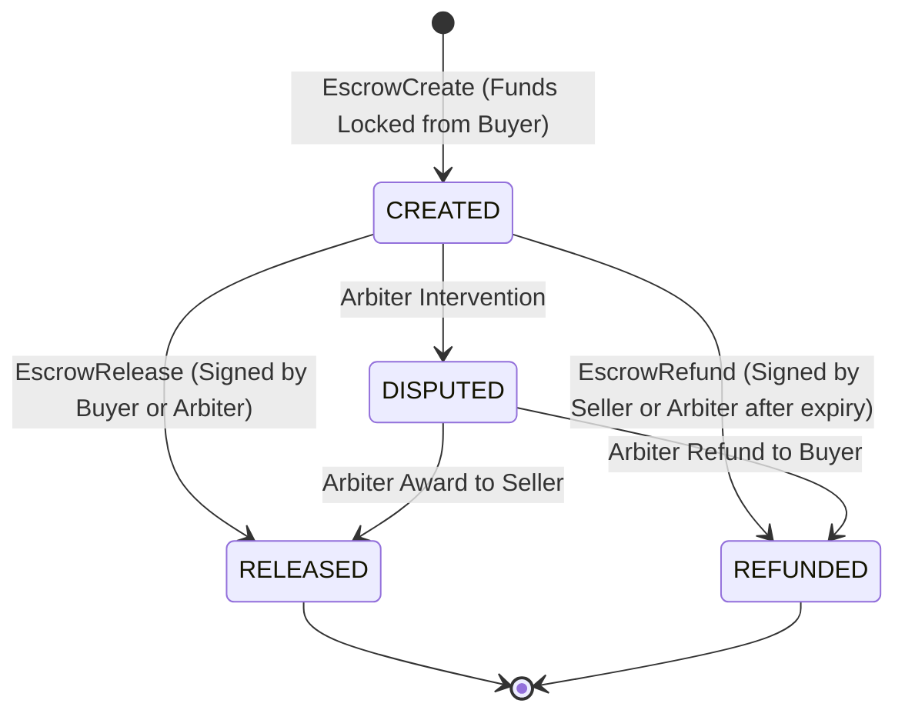

# M3R Validation Protocol & State Transition Rules

**Document:** `research/VALIDATION_PROTOCOL.md`  
**Date:** November 12, 2026  
**Target Architecture:** Node Software & Transaction Processing Pipeline  

---

## 1. Transaction Validation Specification

Every transaction submitted to the M3R network via `POST /{network}/tx/submit` or peer validation endpoints undergoes strict structural, cryptographic, and stateful verification before acceptance or execution.

### 1.1 Structural Decoding
A raw transaction payload `rawTxHex` is binary-encoded and parsed by `TxDecoder`:
- **Version:** 2 bytes (`0x0001` for Alpha protocol)
- **Chain ID:** 4 bytes unsigned int (1 for `mainnet`, 2 for `testnet`)
- **Transaction Type:** 1 byte (`0x00` = TRANSFER, `0x01` = ESCROW_CREATE, `0x02` = ESCROW_RELEASE, `0x03` = ESCROW_REFUND)
- **Account Nonce:** 8 bytes unsigned int
- **Transaction Fee:** 8 bytes unsigned int
- **Timestamp:** 8 bytes unsigned int (epoch seconds)
- **Sender Address (`fromAddr20`):** 20 bytes raw payload
- **Payload Data:** 4 bytes length prefix followed by type-specific bytes:
  - For TRANSFER: `toAddr20` (20 bytes) + `amount` (8 bytes)
- **Memo Field:** 4 bytes length prefix followed by arbitrary text bytes
- **Signature Scheme:** 1 byte (`0x01` = ECDSA secp256k1)
- **Digital Signature:** 4 bytes length prefix followed by ASN.1 DER encoded signature

### 1.2 Cryptographic Verification
1. **Payload Commitment:** The byte sequence starting from `version` through `sigScheme` constitutes `encodeForSigning`.
2. **Digest Computation:**
   $$\mathcal{D} = \text{Keccak-256}(\text{encodeForSigning})$$
3. **Sender Derivation:**
   $$\text{DerivedAddr20} = \text{Keccak-256}(\text{CompressedPubKey})_{12..31}$$
   The decoded `fromAddr20` must match $\text{DerivedAddr20}$ byte-for-byte. If mismatched, the transaction is rejected with `Invalid public key (derived address mismatch)`.
4. **Signature Verification:**
   $$\text{ECDSA\_Verify}_{\text{secp256k1}}(\mathcal{D}, \text{Signature}, \text{CompressedPubKey}) \stackrel{?}{=} \text{True}$$
   If verification fails, the transaction is rejected with `Digital signature verification failed`.

### 1.3 Stateful Ledger Validation
1. **Replay & Idempotence Check:** If $\text{SHA-256}(\text{rawTxHex})$ exists in `transactions` or `tx_ledger`, the transaction is recognized as already processed.
2. **Account Nonce Ordering:**
   The account is locked via `SELECT * FROM accounts WHERE network = :network AND address = :address FOR UPDATE`.
   $$Nonce_{tx} \stackrel{?}{=} Nonce_{ledger} + 1$$
   If $Nonce_{tx} \ne Nonce_{ledger} + 1$, the transaction is rejected with `Invalid nonce (tx=..., expected=..., ledger=...)`.
3. **Balance Sufficiency:**
   $$\text{AvailableBalance} \ge \text{Amount} + \text{TotalFee}$$
   where $\text{TotalFee} = \text{BroadcastFee} + \text{ConsensusFee}$. If insufficient, rejected with `Insufficient funds`.

---

## 2. Block Validation Protocol

Every block received via peer broadcast (`POST /{network}/blocks/receive`) or checked prior to voting (`POST /{network}/blocks/vote`) is evaluated against the following criteria:

| Check Code | Rule Description | Severity |
| :--- | :--- | :--- |
| `MISSING_FIELDS` | Height, hash, slot, Merkle root, or proposer address is null | Fatal Reject |
| `BLOCK_HASH_MISMATCH` | $\text{SHA-256}(header) \ne \text{blockHash}$ | Fatal Reject |
| `PARENT_HASH_MISMATCH` | $parentBlockHash \ne \text{Block}(H-1).blockHash$ | Fatal Reject |
| `PARENT_NOT_FOUND` | Block height $H > 1$ but block $H-1$ is absent | Sync Trigger |
| `PROPOSER_NOT_REGISTERED`| Proposer address does not exist in `validators` table | Fatal Reject |
| `PROPOSER_NOT_ACTIVE` | Proposer validator status $\ne \text{ACTIVE}$ | Fatal Reject |
| `PROPOSER_NOT_SLOT_LEADER`| Proposer address $\ne \text{selectValidatorForSlot}(slotNumber)$ | Fatal Reject |
| `PROPOSER_PUBKEY_MISMATCH`| Proposer public key does not hash to proposer address | Fatal Reject |
| `PROPOSER_SIGNATURE_INVALID`| Proposer secp256k1 signature over header bytes fails | Fatal Reject |
| `TIMESTAMP_FUTURE` | Block timestamp is $> 30\text{ seconds}$ in the future | Fatal Reject |
| `TIMESTAMP_TOO_OLD` | Block timestamp is $> 300\text{ seconds}$ in the past | Fatal Reject |
| `MERKLE_ROOT_MISMATCH` | Recomputed Merkle root of transaction hashes $\ne merkleRoot$ | Fatal Reject |
| `TX_COUNT_MISMATCH` | Count of transactions in list $\ne txCount$ | Fatal Reject |
| `ALREADY_KNOWN` | Block at this height with identical hash is already stored | Non-fatal (Ack) |

---

## 3. Escrow State Machine & Authorization

1. **Creation:** Buyer locks poisha into escrow account. The locked balance cannot be spent by buyer or seller until resolved.
2. **Release:** Requires authorization from buyer or designated arbiter. Funds are transferred to seller minus protocol fees.
3. **Refund:** Requires authorization from seller or designated arbiter after `expiryTs`. Funds are returned to buyer.
